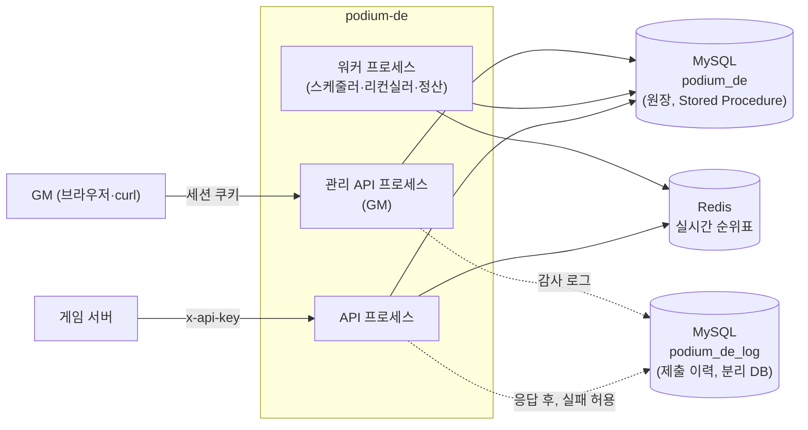

# podium-de (Podium DE)

> 게임 프로젝트에 시즌 기반 랭킹·정산·보상 전달을 제공하는 싱글테넌트(Dedicated Edition)
> 랭킹 플랫폼 — MySQL 원장 + Redis 투영 구조를 실제로 부딪혀 보기 위한 포트폴리오 프로젝트

---

## 요약

시즌 랭킹 서버 + 정산 워커. 스코어를 의미 없는 정수로 다루고, 랭킹 정의(갱신 규칙·정렬
방향·범위)의 조합으로 최고 기록·타임어택·누적 포인트를 표현한다. 보상은 `reward_code`만
판정하고 실제 지급은 게임 서버가 담당한다.

- **핵심 기술**: Node.js 22 + TypeScript · MySQL 8.4(모든 DB 로직은 Stored Procedure,
  LIST COLUMNS 파티션) · Redis 7.4(실시간 순위표, MySQL의 투영)
- **정량 현황**: 5단계(아카이브 로테이션)까지 완료, 6단계 진행 중(관리 API 기반, 랭킹 등록·수정, 제재 완료). 로컬 PC 1대 기준 API 1대당 제출 1,500건/초 안정, 피크 2,300건/초는 API 2대로 처리 ([06_LOAD_TEST](docs/06_LOAD_TEST.md))
- **기술적 강조점**: 시즌 단위 파티션 EXCHANGE 아카이브 · composite score 동점 처리 ·
  동기화 시각 차분 리컨실러 기반 자가 복구 · 동적 SQL을 `SP_EXEC_DDL` 하나로 격리

설계의 단일 기준은 [`docs/01_DESIGN.md`](docs/01_DESIGN.md)(현재 설계)와
[`docs/02_DECISIONS.md`](docs/02_DECISIONS.md)(결정과 이유)다. 01과 02가 다르면 현재 설계인 01을 따른다.
이 README는 프로젝트 개요와 빠른 시작만 두고, 상세는 [문서 목록](#문서-목록)의 각 문서에 둔다.
처음 보는 용어(원장, 센티넬, 리컨실러, `D-xx` 등)는 [00_GLOSSARY](docs/00_GLOSSARY.md)에 있다.

---

## 목차

- [요약](#요약)
- [왜 만들었나](#왜-만들었나)
- [핵심 아이디어](#핵심-아이디어)
- [기술적 도전과 해결](#기술적-도전과-해결)
- [서버 구조](#서버-구조)
- [기술 스택](#기술-스택)
- [주요 기능](#주요-기능)
- [문서 목록](#문서-목록)
- [프로젝트 구조](#프로젝트-구조)
- [실행 방법](#실행-방법)
- [AI 활용](#ai-활용)
- [현재 상태](#현재-상태)
- [한계 및 개선 과제](#한계-및-개선-과제)
- [라이선스](#라이선스)

---

## 왜 만들었나

보상이 걸린 랭킹은 기록 하나의 유실이 CS 사고가 되고, 정산·검수·어뷰징 조사에는 감사
가능한 원장이 필요하다. Redis 단독 랭킹으로는 이를 채울 수 없어, MySQL을 원장으로 두고
Redis를 언제든 재구축 가능한 투영으로 다루는 구조를 직접 설계·구현해 보기 위해 시작했다.
배경과 검토한 대안은 [D-01](docs/02_DECISIONS.md#d-01),
[D-02](docs/02_DECISIONS.md#d-02) 참고.

## 핵심 아이디어

- **MySQL이 원장, Redis는 투영** — Redis 값은 MySQL 행 하나와 랭킹 정의만으로 결정적으로
  계산된다. 상세: [01_DESIGN 1.5](docs/01_DESIGN.md#s-1-5)
- **상태 전이는 시각과 관측에 묶는다** — 마감은 잡 실행 여부가 아니라 SP의 시각 검사로
  결정한다. 상세: [01_DESIGN 3.5](docs/01_DESIGN.md#s-3-5),
  [D-11](docs/02_DECISIONS.md#d-11)
- **운영 테이블에서 무거운 작업을 하지 않는다** — 운영 테이블 DDL은 메타데이터 수준으로
  제한하고, 정산·삭제는 EXCHANGE로 분리한 테이블에서 수행한다. 상세:
  [01_DESIGN 8](docs/01_DESIGN.md#8-아카이브)

## 기술적 도전과 해결

세 해법 모두 구현했고 회귀 테스트로 검증한다([08_TEST_CASES](docs/08_TEST_CASES.md)). 실측 처리량은 [06_LOAD_TEST](docs/06_LOAD_TEST.md)에 있다.

### 1. 동점 순위를 Redis 정렬만으로 고유하게

- **문제**: 같은 점수면 먼저 달성한 쪽이 위여야 하고, 조회 시 별도 정렬 없이 순위가 나와야 한다.
- **해결**: 점수와 달성 시각을 하나의 ZSET score에 비트 분할로 인코딩하고, 등록 시 비트
  예산을 검증한다. 상세: [01_DESIGN 2.4·5.2](docs/01_DESIGN.md#s-2-4),
  [D-05](docs/02_DECISIONS.md#d-05)

### 2. 공유 운영 테이블에서 시즌 데이터를 무중단으로 분리

- **문제**: 데이터가 찬 파티션을 직접 DROP하면 배타 MDL을 잡은 채 파일 삭제가 진행돼 모든
  랭킹의 쓰기가 멈춘다.
- **해결**: 시즌 파티션을 일반 테이블과 EXCHANGE 1회로 분리하고, 그 테이블을 그대로 백업으로
  쓴다. 상세: [01_DESIGN 8.1\~8.3](docs/01_DESIGN.md#s-8-1),
  [D-18](docs/02_DECISIONS.md#d-18)

### 3. MySQL 커밋 후 Redis 반영 유실

- **문제**: 프로세스가 MySQL 커밋 직후 종료되면 Redis 반영 실패 기록조차 남지 않는다.
- **해결**: 즉시 재시도(L1) + `updated_at` 동기화 시각 차분 리컨실러(L2) + 센티넬 기반 전체
  재구축(L3)의 3단 자가 복구. 상세: [01_DESIGN 6](docs/01_DESIGN.md#6-정합성과-자가-복구)

---

## 서버 구조



API, 워커, 관리 API는 같은 코드베이스의 별도 엔트리다. 테이블·SP 상세는
[`docs/01_DESIGN.md`](docs/01_DESIGN.md) 2\~4장, 7\~8장, 11장 참고.

---

## 기술 스택

| 항목 | 스택 |
|---|---|
| 런타임/언어 | Node.js 22 LTS + TypeScript |
| HTTP | Fastify 5 (요청 스키마 검증, Swagger) |
| DB | MySQL 8.4 (mysql2, ORM 미사용 — 모든 DB 로직은 Stored Procedure) |
| 캐시 | Redis 7.4 (node-redis) |
| 배포 모델 | 싱글테넌트, 프로젝트별 독립 배포 |

---

## 주요 기능

- **랭킹 정의** — 갱신 규칙(BEST/SUM, LATEST는 2차) × 정렬 방향 × 시즌 주기 조합
- **스코어 적재** — 시각 기반 마감, `requestId` 멱등 키, 하드 검증(범위·최대 증분)
- **실시간 순위** — 상위 페이징, 내 순위 조회
- **정산** — 가순위 생성 → 검수 → 확정 → 일괄 보상 전달(게임 서버 pull + ack)
- **보상 구간** — 순위(RANK) 또는 참가자 대비 백분율(PERCENT). 한 사람은 보상 하나만 받고, 겹치면 RANK가 먼저다. 판정 규칙: [01_DESIGN 2.6](docs/01_DESIGN.md#s-2-6)
- **제재** — 시즌 중 실시간 순위 제외, 검수 전 제재는 확정에서 제외 후 순위 재부여, 검수 후 제재는 표시만
- **Anti-cheat** — 소프트 탐지, 어뷰징 포인트 (6단계 구현 예정)
- **관리 API** — GM 계정·역할·감사 로그, 랭킹 등록·수정, 제재 등록·해제
- **아카이브** — 시즌별 백업 테이블, 시즌별 Top N 영구 보관(ranking_season_top)

범위와 구현 순서: [01_DESIGN 12](docs/01_DESIGN.md#12-구현-범위와-순서)

---

## 문서 목록

| 문서 | 내용 |
|---|---|
| [00_GLOSSARY.md](docs/00_GLOSSARY.md) | 용어집. 처음 읽을 때 옆에 둔다 |
| [01_DESIGN.md](docs/01_DESIGN.md) | 현재 설계(단일 기준) |
| [02_DECISIONS.md](docs/02_DECISIONS.md) | 결정 기록 — 배경, 검토한 대안, 이유 |
| [03_DEV_SETUP.md](docs/03_DEV_SETUP.md) | 로컬 개발 환경(스키마·계정 생성, 실행, Swagger, 회귀 테스트) |
| [04_SCHEMA.md](docs/04_SCHEMA.md) | 테이블 목록, ERD, 시즌 데이터 흐름 |
| [05_TROUBLESHOOTING.md](docs/05_TROUBLESHOOTING.md) | 운영 장애 대응, 개발 중 겪은 문제와 해결 |
| [06_LOAD_TEST.md](docs/06_LOAD_TEST.md) | 부하 테스트 결과 보고서 (처리량, 지연, 병목, 재현 방법) |
| [07_K6_LOAD_TEST.md](docs/07_K6_LOAD_TEST.md) | k6 부하 테스트 결과와 따라 하기 (설치, 실행, 결과 해석, 정리) |
| [08_TEST_CASES.md](docs/08_TEST_CASES.md) | 회귀 테스트 항목 번호별 설명 (tests/cases-doc.mjs가 생성) |
| [09_OPERATIONS.md](docs/09_OPERATIONS.md) | 운영·배포 (프로세스와 대수, 중단 패치·롤링, upgrade, migrate 거부 대응, 마이그레이션 규칙) |

---

## 프로젝트 구조

```
podiumDE/
├── src/
│   ├── *.ts             # 프로세스 엔트리(api, worker, admin)와 CLI(migrate, upgrade, credential, admin)
│   ├── core/            # 공통 기반: DB·SP 호출, Redis·Lua, 결과 코드·오류, 로거, 설정, 기동·하트비트
│   ├── api/             # 게임 서버용 API: 인증, 제출, 순위 조회, 결과·보상
│   ├── admin/           # 관리 API: 세션·역할, 계정, 랭킹 등록·수정, 제재, 감사 로그
│   └── worker/          # 워커 잡: 스케줄러, 자가 복구, 정산, 보상 전달, 백업 분리, 로그 정리
├── database/            # 메인 DB: tables(버전 마이그레이션), functions·procedures(반복 마이그레이션), TABLE_LOCK_ORDER.md
├── database_log/        # 로그 DB(podium_de_log), database/와 같은 규칙
├── config/log4js.json   # 로깅 설정(재빌드 없이 파일만 수정하면 반영)
├── loadtest/            # 부하 테스트 스크립트(로컬 전용, docs/06·07)
├── tests/               # 회귀 테스트 recovery.mjs, 항목 문서 생성 cases-doc.mjs(로컬 전용, docs/03 4.4·08)
└── docs/                # 문서(위 목록)
```

---

## 실행 방법

최초 설치

```bash
npm install
cp .env.example .env    # DB 접속 정보(앱·migrate 계정) 채우기
npm run build           # TypeScript 컴파일(dist/)
npm run migrate         # 테이블·SP 적용
npm run admin -- create --login-id <아이디> --name <이름>   # 첫 관리 계정
npm run credential -- create <이름> write,read,reward      # 게임 서버용 API 키
```

MySQL에 `podium_de`, `podium_de_log` 스키마와 두 계정(migrate, 앱)을 먼저 만들어 둔다. 상세 절차는
[`docs/03_DEV_SETUP.md`](docs/03_DEV_SETUP.md).

상시 실행 프로세스는 세 가지다.

| 명령 | 프로세스 | 역할 |
|---|---|---|
| `npm run start:api` | API | 게임 서버의 S2S 요청(제출, 순위 조회, 보상 목록·ack) |
| `npm run start:worker` | 워커 | 스케줄러, 리컨실러, 정산, 보상 전달, 아카이브 |
| `npm run start:admin` | 관리 API | GM 계정·세션 쿠키 인증 관리 기능 |

권장 대수, 배포(중단 패치·롤링), `npm run upgrade`, migrate 거부 대응, 마이그레이션 규칙은
[`docs/09_OPERATIONS.md`](docs/09_OPERATIONS.md)에 있다.

---

## AI 활용

데이터 모델, 파티션·아카이브 전략, 정합성·정산 흐름 같은 설계 결정은 개발자가 먼저 판단하고
[`docs/02_DECISIONS.md`](docs/02_DECISIONS.md)에 기록한 뒤, Claude Code로 그 설계를 코드로
구현하고 로컬 DB에서 검증하는 데 활용했다. 설계와 다르게 구현해야 할 이유가 생기면 임의로
바꾸지 않고 먼저 논의한 뒤 결정했다.

| 도구 | 용도 |
|---|---|
| Claude Code | 스키마·SP·코드 초안 작성, 로컬 MySQL 검증 실행 보조 |

---

## 현재 상태

- ✅ 1단계: 프로젝트 골격, 마이그레이션 러너, 스키마, 파티션 관리 SP, 스코어 적재 SP
  - ✅ 마이그레이션 러너(버전·반복 마이그레이션, 체크섬, 기동 시 스키마 확인), 하트비트, 중단 패치(`npm run upgrade`)
  - ✅ 테이블 DDL — 메인 DB 13개, 로그 DB 2개 (DB 계정 분리, 로그 DB 물리 분리)
  - ✅ 파티션·정산 관리 SP (`SP_PARTITION_*`, `SP_SETTLING_EXCHANGE`, 로그 DB 일 파티션)
  - ✅ 로그 정리 잡 — 로그 DB 일 파티션을 오늘 + 7일까지 미리 만들고 보관 기간이 지난 파티션 정리(5단계부터 월 테이블로 이동), 1시간 주기, `p_max` 행 경고, 정체 감시(3시간)
  - ✅ 스코어 적재 SP `SP_SUBMIT_SCORE` (BEST/SUM, 멱등 키, 하드 검증)
- ✅ 2단계: API 인증, 제출 API, Redis 반영, 순위 조회 → 부하 테스트
  - ✅ API 키 테이블·SP, 발급·폐기 CLI(`npm run credential`)
  - ✅ Fastify 서버 기반 — 결과 코드 체계, 오류 변환, 요청 로그·마스킹, 시간 초과, Swagger
  - ✅ 인증 가드 (활성 키 메모리 목록, 권한 비트)
  - ✅ 스코어 제출 API + Redis 반영 (빈도 검사, 멱등 재전송, 제출 이력)
  - ✅ 순위 조회 API (상위, 내 순위, 현재 시즌)
  - ✅ 부하 테스트 — API 2개로 피크 제출 2,300건/초, p99 130ms 이하 ([06_LOAD_TEST](docs/06_LOAD_TEST.md))
  - ✅ k6 대조 측정 — 표준 도구로 API 1대 안정 범위(제출 1,500건/초, p99 95.8ms) 재확인, 따라 하기 절차 포함 ([07_K6_LOAD_TEST](docs/07_K6_LOAD_TEST.md))
- ✅ 3단계: 자가 복구(리컨실러, 센티넬, 재구축)
  - ✅ 워커 복구 잡 — 시즌마다 센티넬이 없으면 재구축, 있으면 동기화 시각 차분 반영, 시작 60초 전 미리 준비, 1시간 1회 건수 점검 ([D-60](docs/02_DECISIONS.md#d-60))
- ✅ 4단계: 시즌 스케줄러(생성, 상태 전이, 정산, 전달)
  - ✅ 시즌 생성·상태 전이 — timezone 경계 계산, "현재 + 다음 2개" 선행 생성과 파티션, SCHEDULED→OPEN→CLOSED ([D-62](docs/02_DECISIONS.md#d-62), [D-63](docs/02_DECISIONS.md#d-63))
  - ✅ 정산 가순위 — 시작 조건(7.1), 작업 테이블 꺼내기·청크 가순위·되돌리기, Redis 시즌 키 삭제, REVIEW 전이 ([D-65](docs/02_DECISIONS.md#d-65), [D-66](docs/02_DECISIONS.md#d-66))
  - ✅ 확정(FINALIZING) — 검수 종료·보류 확인, 제재 제외, 순위 재부여와 보상 판정(청크), 구간 스냅샷, 시즌 Top N, DELIVERING 전이, PERCENT "앞 사람 비율" 판정·RANK 우선·보상 공백 경고 ([D-68](docs/02_DECISIONS.md#d-68), [D-69](docs/02_DECISIONS.md#d-69))
  - ✅ 보상 전달·결과 조회 — 결과·내 결과·시즌 Top N API, 보상 목록(커서)·ack(멱등)·대기 시즌 API, SETTLED 전이, ack 정체·적체 경고 ([D-70](docs/02_DECISIONS.md#d-70))
- ✅ 5단계: 아카이브 로테이션
  - ✅ 시즌 백업 테이블 로테이션 — SETTLED 시즌 파티션 분리(1시간 주기), 백업 COMMENT(코드·기간), `history_retention` 지난 백업 경고, 정체 감시 ([D-73](docs/02_DECISIONS.md#d-73))
  - ✅ 로그 DB 월 테이블 아카이브 — 일 파티션 EXCHANGE 두 번(복사 없음, 중단 후 이어서), `LOG_ARCHIVE_MONTHS` 후 월 테이블 삭제 ([D-72](docs/02_DECISIONS.md#d-72))
- ⬜ 6단계: Anti-cheat, 운영 도구, 설치 패키징
  - ✅ 관리 API 기반 — `start:admin` 프로세스, 계정·세션·감사 로그, 로그인·비밀번호 변경·잠금, 첫 admin CLI, 역할 확인 ([D-74](docs/02_DECISIONS.md#d-74), [D-80](docs/02_DECISIONS.md#d-80))
  - ✅ 랭킹 등록·수정 — 등록 검증(비트 예산, 일정 시험 계산, 정산 기간, 보상 구간), 묶음별 수정, 늘리기·줄이기·조기 종료·ENDED·PAUSED, 스케줄러 락 직렬화, 현재 시즌 캐시 30초 상한 ([D-79](docs/02_DECISIONS.md#d-79), [D-81](docs/02_DECISIONS.md#d-81))
  - ✅ 제재 — 반영 Lua 제외 집합, 등록·해제·목록 API, 리컨실러 1분 동기화, 재구축 전 다시 채우기, 검수 전 제재만 확정 제외·검수 후 제재는 표시만 ([D-75](docs/02_DECISIONS.md#d-75), [D-78](docs/02_DECISIONS.md#d-78))
  - ⬜ 검수·전달 조작 — 검수 보류·해제·조기 확정, 장기 보류 알림, 검수 목록, DELIVERING 강제 종료
  - ⬜ Anti-cheat — 소프트 탐지 4규칙, 탐지 중복 방지, 검수 목록 포인트 정렬 ([D-76](docs/02_DECISIONS.md#d-76), [D-77](docs/02_DECISIONS.md#d-77))
  - ⬜ 정리 — `reward_held` 조건 제거(SP, 회귀 테스트, 03_DEV_SETUP 문구)
  - ⬜ 설치 패키징 — 배포 형태, 설치 절차, 설정 안내
- ⬜ 7단계: 운영 웹 프론트엔드 (보상 공백 표시 포함, [D-69](docs/02_DECISIONS.md#d-69))

---

## 한계 및 개선 과제

- **2차 이후 범위** — LATEST 갱신 규칙, 늦은 제출 허용, 친구·길드 랭킹 등은 1차 범위
  밖이다. 목록: [01_DESIGN 12.2](docs/01_DESIGN.md#s-12-2)
- **처리량은 단일 장비 측정치** — 로컬 PC 한 대에서 API 2개로 피크 추정치(2,300건/초)를
  처리했다. DB·Redis·API를 분리한 환경의 상한은 미측정이다.
  결과: [06_LOAD_TEST](docs/06_LOAD_TEST.md), 근거: [D-02](docs/02_DECISIONS.md#d-02)
- **DB 변경 배포는 점검 시간이 필요하다** — 테이블·SP 변경이 있으면 전체 중지 → migrate →
  기동으로 배포한다. 점검 없이 상시 운영하는 게임을 지원하려면 무중단 마이그레이션을 검토한
  [D-38](docs/02_DECISIONS.md#d-38)을 다시 열어야 한다.

## 라이선스

이 프로젝트는 채용 과정에서의 열람·평가 및 개인적인 학습·참고 목적으로 공개됩니다.
상업적 이용(실제 서비스, 사내 시스템 포함)은 금지됩니다. 자세한 내용은
[LICENSE.md](LICENSE.md)를 참고하세요.
